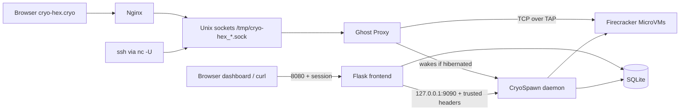

# ❄️ CryoSpawn

CryoSpawn is a Linux MicroVM platform built on AWS Firecracker and Linux KVM. A C++17 daemon manages VM lifecycles and isolated networks; a Flask frontend provides authentication, projects, and the dashboard.

## ✨ Features

- **Hibernation:** idle VMs are snapshotted to disk and their Firecracker process is stopped, so they use no CPU or RAM.
- **Ghost Proxy auto-wake:** traffic to a sleeping VM restores it from the snapshot and is then delivered.
- **No host port pollution:** SSH, HTTP and HTTPS are exposed through Unix Domain Sockets and a single Nginx ingress (`cryo-<hex>.cryo`).
- **Zero-trust networking:** every VM has its own `/30` subnet and cannot reach other VMs unless you link them.
- **UUIDs and names:** every VM has a name and a public ID like `vm-da05a06c`; the API, TAP devices, sockets and disk files all use it.
- **Login and ownership:** Flask sessions identify users, and the daemon tags VMs and volumes with owners.
- **Projects and routing:** VMs can be grouped into projects, with explicit opt-in for cross-project routing.
- **Volumes and root disk sizing:** extra ext4 volumes can be attached to VMs, and each VM's root disk size is configurable.
- **Persistence:** state lives in SQLite, so the daemon re-adopts running VMs after a restart.

## 🧭 How it fits together



## 🚀 Quick start

```bash
cd internal
g++ -std=c++17 main.cpp -o cryospawn -pthread -lsqlite3
cd ..
./utils/download_assets.sh
python3 -m venv .venv
. .venv/bin/activate
pip install flask requests
sudo -E ./internal/cryospawn
python frontend/app.py
```

Run the daemon and frontend in separate terminals from the project root. Open `http://localhost:8080` and sign in with `admin` / `admin123` on the first start, then change the password. Prerequisites and full configuration are in [docs/SETUP.md](docs/SETUP.md).

Create a VM from the command line:

```bash
curl -c jar -X POST http://localhost:8080/api/auth/login   -H 'Content-Type: application/json' -d '{"username":"admin","password":"admin123"}'
curl -b jar -X POST http://localhost:8080/api/vms   -H 'Content-Type: application/json'   -d '{"name":"web-1","vcpus":1,"mem_mib":512,"expose_http":true}'
```

## 🗂️ Repository layout

| Path | Contents |
| :--- | :--- |
| `internal/` | Daemon source (`main.cpp`, `config.hpp`, `orchestrator.hpp`, `network.hpp`, `proxy.hpp`, `database.hpp`) |
| `internal/ui/` | Dashboard pages (login, MicroVMs, volumes, networks, settings) and `app.js` |
| `frontend/` | Flask app: login, sessions, serves the dashboard, forwards `/api/*` |
| `site/` | Animated flow-map website, deployed to GitHub Pages |
| `nginx/` | Legacy and example Nginx ingress scripts |
| `utils/` | Build, cleanup and guest helper scripts |
| `docs/` | Setup, API, DNS and known-issues documentation |

## 📚 Documentation guide

| Doc | Read it for |
| :--- | :--- |
| [docs/SETUP.md](docs/SETUP.md) | Prerequisites, configuring paths, building, running, reaching VMs |
| [docs/API.md](docs/API.md) | Every HTTP endpoint with request and response details |
| [docs/DNS.md](docs/DNS.md) | Planned Cloudflare and Nginx ingress for a public domain |
| [docs/KNOWN-ISSUES.md](docs/KNOWN-ISSUES.md) | Current limitations and workarounds |
| [DESIGN.md](DESIGN.md) | Architecture, database schema, networking and data flows |
| [ROADMAP.md](ROADMAP.md) | Platform vision and engineering milestones |
