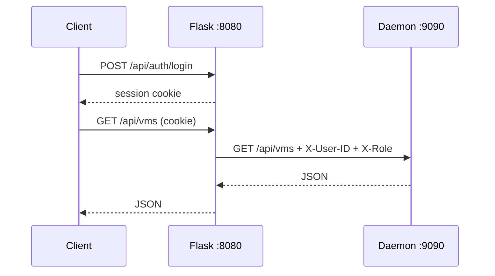

# 🔌 CryoSpawn HTTP API

> **Written for:** developers and operators who call CryoSpawn directly (scripts, `curl`, the dashboard frontend).

CryoSpawn has two HTTP layers:

| Layer | Address | Role |
| :--- | :--- | :--- |
| Flask frontend ([frontend/app.py](../frontend/app.py)) | `0.0.0.0:8080` | Login and sessions, serves the dashboard from `internal/ui/`, forwards `/api/*` to the daemon |
| C++ daemon ([internal/main.cpp](../internal/main.cpp)) | `127.0.0.1:9090` | The REST API that manages VMs, links and volumes |

Clients talk to **port 8080**. The daemon on 9090 is local only and trusts the identity headers that Flask adds.



## 📋 Conventions

- Request and response bodies are JSON (`Content-Type: application/json`).
- Errors return a non-2xx status and, for most of them, a body like `{"error": "..."}`.
- VMs are addressed by **UUID** (`vm-` plus 8 hex characters, e.g. `vm-da05a06c`). The integer `id` in responses is the internal **slot**, used only for IP allocation. See [DESIGN.md](../DESIGN.md#3-database-design-the-systems-memory).
- Flask rejects every `/api/*` call except the login route with `401` when there is no session. If the daemon is down it answers `502`.
- The daemon allows every origin through CORS (`Access-Control-Allow-Origin: *`).

> [!IMPORTANT]
> Expose only port 8080. Port 9090 has no login of its own: it believes whatever `X-User-ID` and `X-Role` header it receives. See [KNOWN-ISSUES.md](KNOWN-ISSUES.md).

## 🔐 Authentication (Flask, port 8080)

Sessions use a cookie, so keep it between calls (`curl -c jar -b jar`).

| Method | Endpoint | Body | Response |
| :--- | :--- | :--- | :--- |
| `POST` | `/api/auth/login` | `{"username": "admin", "password": "..."}` | `{"status": "success", "role": "admin"}`; `401` with `{"error": "Invalid credentials"}` |
| `POST` | `/api/auth/logout` | none | `{"status": "success"}` |
| `GET` | `/api/auth/me` | none | `{"user_id": 1, "username": "admin", "role": "admin"}`; `401` if not logged in |

A first start creates the user `admin` (role `admin`) with the password `admin123` when the `users` table is empty. Change it: see [SETUP.md](SETUP.md#-first-login).

```bash
curl -c jar -X POST http://localhost:8080/api/auth/login \
  -H 'Content-Type: application/json' \
  -d '{"username":"admin","password":"admin123"}'
```

The dashboard pages (`/dashboard`, `/volumes`, `/networks`, `/settings`) redirect to `/login` without a session.

## 🖥️ MicroVMs

| Method | Endpoint | Purpose |
| :--- | :--- | :--- |
| `GET` | `/api/vms` | List VMs (all of them for an admin, only the caller's own otherwise) |
| `POST` | `/api/vms` | Create and boot a VM |
| `DELETE` | `/api/vms/:uuid` | Terminate a VM and remove its resources |
| `POST` | `/api/vms/:uuid/hibernate` | Snapshot to disk and stop the Firecracker process |
| `POST` | `/api/vms/:uuid/wake` | Restore a hibernated VM |
| `POST` | `/api/vms/:uuid/restart` | Reboot the VM in place |
| `PATCH` | `/api/vms/:uuid/ports` | Turn SSH, HTTP and HTTPS exposure on or off |
| `POST` | `/api/vms/:uuid/proxy` | Start a Ghost Proxy for an arbitrary VM port |

Except for `DELETE`, these handlers answer `404` for an unknown UUID and `403` when a non-admin caller does not own the VM.

### `GET /api/vms`

Returns an array of VM objects.

| Field | Type | Meaning |
| :--- | :--- | :--- |
| `id` | int | Slot (internal index, not an API identifier) |
| `uuid` | string | VM identifier, e.g. `vm-da05a06c` |
| `name` | string | Human-readable name |
| `ip` | string | Guest IP, e.g. `172.16.0.2` |
| `host_ip` | string | Host-side TAP gateway IP |
| `status` | string | `booting`, `running`, `hibernated`, `waking` or `restarting` |
| `vcpus` | int | Virtual CPU count |
| `mem_mib` | int | RAM in MiB |
| `rootfs_gb` | int | Requested root disk size in GB |
| `tap_name` | string | Host TAP device, e.g. `cryo-da05a06c` |
| `ssh_exposed`, `http_exposed`, `https_exposed` | bool | Ghost Proxy exposure flags |
| `host_port` | int | Legacy field |
| `host_lan_ip` | string | LAN IP of the host's active interface |
| `project` | string | Project namespace |

### `POST /api/vms`

All fields are optional. The body itself may be omitted.

| Field | Type | Default | Notes |
| :--- | :--- | :--- | :--- |
| `name` | string | `""` | Display name (the dashboard form requires one) |
| `vcpus` | int | `1` | |
| `mem_mib` | int | `512` | |
| `expose_ssh` | bool | `false` | Starts the port 22 Ghost Proxy |
| `expose_http` | bool | `false` | Starts the port 80 Ghost Proxy |
| `expose_https` | bool | `false` | Starts the port 443 Ghost Proxy |
| `project` | string | `"default"` | VMs can only be linked within one project |
| `rootfs_gb` | int | `3` | Root disk size. Values of `3` or more expand the disk; smaller values keep the template size |

```bash
curl -b jar -X POST http://localhost:8080/api/vms \
  -H 'Content-Type: application/json' \
  -d '{"name":"web-1","vcpus":2,"mem_mib":1024,"expose_http":true,"project":"lab1","rootfs_gb":5}'
```

Response: `{"id": 0, "uuid": "vm-da05a06c", "name": "web-1", "ip": "172.16.0.2", "status": "booting"}`. Booting continues in the background, so poll `GET /api/vms` until `status` is `running`.

Errors: `400` for invalid JSON, `401` without the identity headers, `500` if creation fails.

### `DELETE /api/vms/:uuid`

Response: `{"status": "deleted"}`; `404` for an unknown UUID.

### `POST /api/vms/:uuid/hibernate` and `/wake`

Responses: `{"status": "hibernated"}` and `{"status": "running"}`. Both return `500` on failure. Waking also happens automatically when traffic reaches a Ghost Proxy.

### `POST /api/vms/:uuid/restart`

Reboots the VM in place (same TAP, disk and UUID). Response: `{"status": "restarting"}`.

### `PATCH /api/vms/:uuid/ports`

Body fields `ssh_exposed`, `http_exposed`, `https_exposed` (bool, each defaults to `false`). Proxies are started or stopped to match. Response: `{"status": "ports updated"}`.

### `POST /api/vms/:uuid/proxy`

Body: `{"host_port": <int>, "vm_port": <int>}`. Only `vm_port` is used: it starts a Ghost Proxy on `/tmp/cryo_vm_<slot>_<vm_port>.sock` forwarding to that port on the VM. Response: `{"status": "proxy_started", "uds": "<socket path>"}`. Errors: `400` invalid request.

> [!NOTE]
> This socket name uses the numeric slot, unlike the exposure sockets (`/tmp/cryo-<hex>_22.sock`, `_80.sock`, `_443.sock`) that `POST /api/vms` and `PATCH .../ports` create. Here `<hex>` is the UUID without the `vm-` prefix.

## 🔗 Network links

Links open traffic between two otherwise isolated VMs. See [DESIGN.md](../DESIGN.md#zero-trust-subnet-isolation--inter-vm-linking).

| Method | Endpoint | Body | Response |
| :--- | :--- | :--- | :--- |
| `GET` | `/api/links` | none | `[{"vm1_uuid": "vm-da05a06c", "vm2_uuid": "vm-1b2c3d4e"}]` |
| `POST` | `/api/links` | `{"vm1_id": "vm-da05a06c", "vm2_id": "vm-1b2c3d4e"}` | `{"status": "linked"}` |
| `DELETE` | `/api/links/:uuid1/:uuid2` | none | `{"status": "unlinked"}` |

In the `POST` body, `vm1_id` and `vm2_id` hold VM **UUIDs**. The call returns `400` with `{"error": "Cross-project linking is denied."}` whenever the manager rejects the pair. That is also what you get if one of the UUIDs does not exist. `500` is returned for other errors.

## 💾 Volumes

Volumes are extra ext4 disks stored as `volumes/vol_<id>.ext4`. A volume is attached to at most one VM, and is added to the VM as a Firecracker drive at boot. Volumes still use integer IDs.

| Method | Endpoint | Body | Response |
| :--- | :--- | :--- | :--- |
| `GET` | `/api/volumes` | none | `[{"id": 1, "name": "data", "size_gb": 2, "attached_vm_id": -1}]` |
| `POST` | `/api/volumes` | `{"name": "data", "size_gb": 2}` | `{"status": "created", "id": 1}` |
| `DELETE` | `/api/volumes/:id` | none | `{"status": "deleted"}` |
| `POST` | `/api/volumes/:id/attach` | `{"vm_id": "vm-da05a06c"}` | `{"status": "attached"}` |
| `POST` | `/api/volumes/:id/detach` | none | `{"status": "detached"}` |

`attached_vm_id` in the listing is the VM's **slot** (an integer), or `-1` when the volume is not attached. The `vm_id` you send to `attach` is the VM's **UUID**.

> [!NOTE]
> Attaching or detaching reboots the target VM if it is `running`, so the change takes effect. Expect a short interruption.
